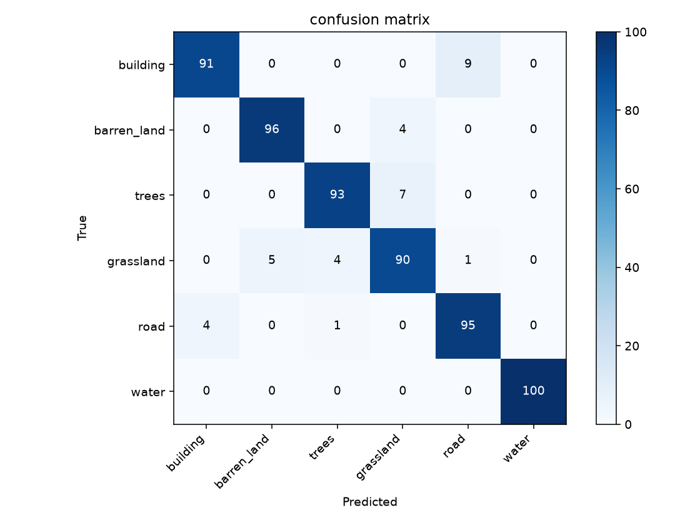

# Satellite land-cover classification with SAT-6

**Pelin Su Kaplan · MLESS Homework 1 · University of Cologne**

A course fork comparing Random Forest and a convolutional neural network (CNN)
on 28 × 28 satellite image patches. The notebooks cover six land-cover classes:
building, barren land, trees, grassland, road, and water.

- [Random Forest notebook](Random_forest_classifier_on_remote_sensing_image.ipynb):
  classification report, confusion matrix, correct and incorrect examples,
  RGB and R+G+NIR comparisons, and a tree-depth sweep.
- [CNN notebook](CNN_classifier_on_remote_sensing_image.ipynb): a three-block
  convolutional model, train-only normalisation, classification report,
  confusion matrix, examples, RGB comparison and a learning-rate experiment.
- [Coursework feedback](FEEDBACK.md).

The notebooks originated with Ankit Patnala (JSC), updated by Martin Schultz
for the course. My coursework adds the evaluations, visualisations, band and
hyperparameter comparisons, and documentation. This fork keeps the assignment
separate from the upstream course material.

## Reproduce the analysis

Use Python 3.11 or newer and run commands from this repository's root:

```bash
python -m venv .venv
source .venv/bin/activate
python -m pip install -r requirements.txt
python -m jupyterlab
```

Download the three files from the [B2SHARE course data record](https://b2share.eudat.eu/records/2p6ra-xfj86)
and keep them in the ignored `data/` directory. The image CSV is about 906 MB.
On macOS or Linux:

```bash
mkdir -p data
for file in X_test_sat6.csv y_test_sat6.csv sat6annotations.csv; do
  curl --fail --location "https://b2share.eudat.eu/records/2p6ra-xfj86/files/$file?download=1" -o "data/$file" || break
done
```

Open each notebook with the project Python environment and run all cells from
the top. The notebooks read local files and make no network requests. Only
selected image rows are kept in memory. CNN training runs on CPU by default
and uses CUDA when available. Do not commit raw data or locally generated
notebook outputs containing dataset images.

## Evaluation design

Both notebooks use the same seed (42) and disjoint, balanced subsets:
1,000 training, 100 validation and 100 test examples **per class**. The
source CSVs come from the original SAT-6 test portion. The splits here are for
the coursework experiment and should not be compared directly to published
SAT-6 benchmark scores. Splitting by row avoids row overlap but does not prove
geographic independence between patches.

Image columns are **pixel-interleaved** R, G, B, NIR. Selecting only green and
NIR means `X.iloc[:, channel_columns(1, 3)]` with the helper from `sat6.py`,
not selecting two contiguous channel blocks. The CNN reshapes rows to HWC
and then converts to CHW for PyTorch.

The original Random Forest split sampled train and test rows independently;
that could leak rows into both sets. A single per-class permutation now assigns
disjoint splits. `extend` adds individual indices to a list; `append` adds
the input as one element. Shuffling reduces class-order effects in training.
One-hot encodings represent categories without ordinality; here both model
APIs are given class indices, which do not imply an ordering in these classifiers.

RF depth and CNN learning-rate curves use validation data. The fixed baseline
and band comparisons are evaluated on the same held-out test rows. Normalisation
uses training rows only. The original notebook scores are not reported as
results of this corrected protocol.

## Results

Accuracy on the same 600 held-out patches (100 per class):

| Input bands | Random Forest | CNN |
| --- | ---: | ---: |
| RGB + NIR | 93.50% | 94.17% |
| RGB | 91.83% | 91.33% |
| R + G + NIR | 92.67% | — |

Both models scored higher with four bands than with RGB on this split. On
validation data, Random Forest accuracy rose from 87.67% at depth 5 to
93.50% with unrestricted depth. After 10 epochs, the CNN reached 94.17%
validation accuracy at a learning rate of 0.001 and 86.67% at 0.0001. Both
models classified all 100 water patches correctly in the four-band test.

| Random Forest | CNN |
| --- | --- |
|  |  |

## Verification

Run `python -m unittest discover -s tests -v` for the split, band selection and CSV alignment checks.
The notebooks also accept `SAT6_TRAIN_PER_CLASS`, `SAT6_VAL_PER_CLASS`,
`SAT6_TEST_PER_CLASS` and `SAT6_EPOCHS` for smaller development runs. Use
defaults when reproducing the full experiment.

Dataset credit: Ankit Patnala’s B2SHARE course subset of SAT-6, from
[Basu et al., DeepSat (2015)](https://arxiv.org/abs/1509.03602). Data are
downloaded separately and are not covered by the repository's code licence.
